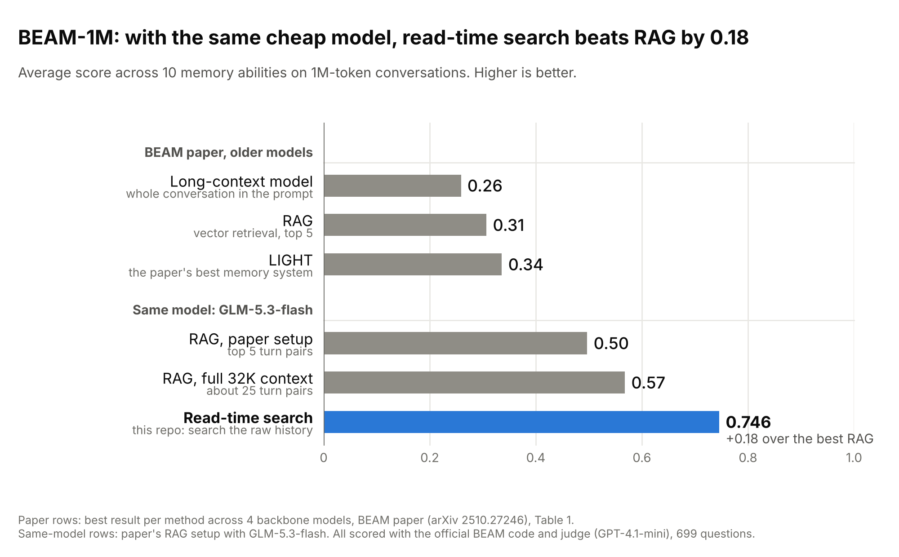
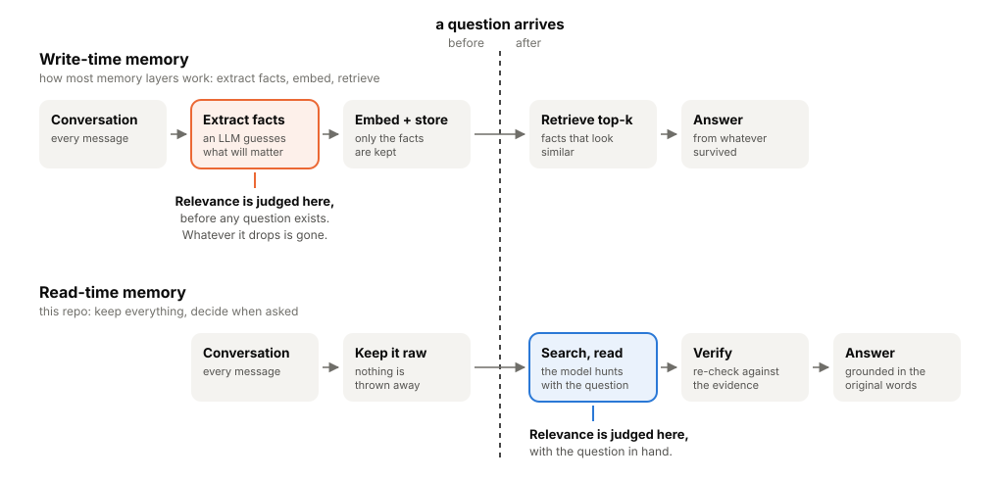
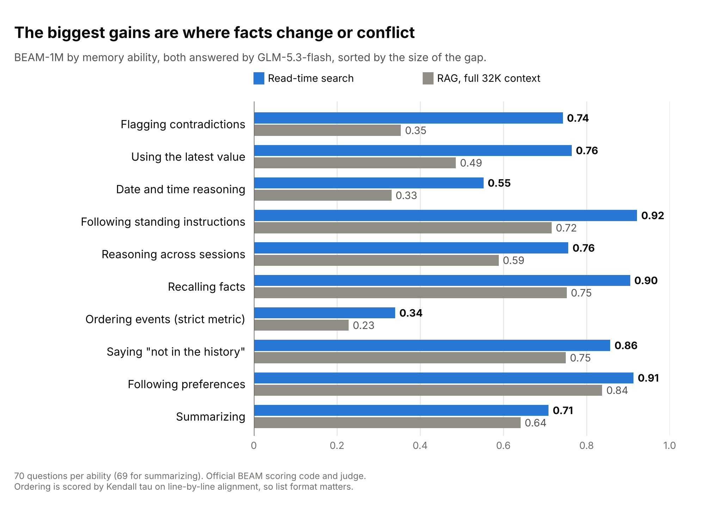
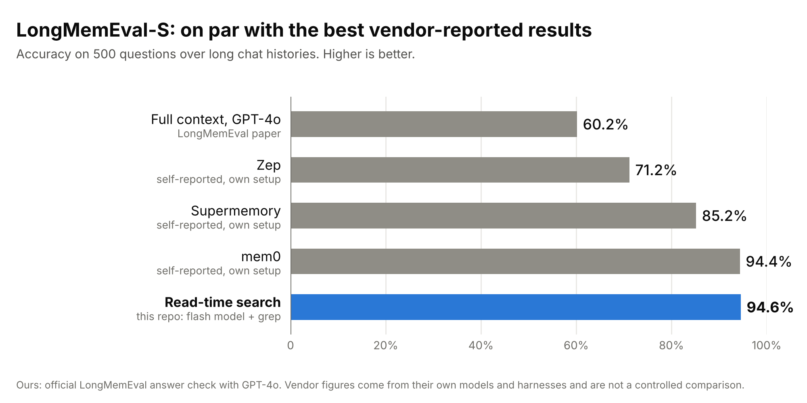

<div align="center">

# Read-time memory

### Relevance can't be judged at write time.

A cheap model that searches the raw conversation history, at the moment a question is asked, scores **2.2x the best published system** on a 1M-token memory benchmark.

    

[Why read-time](#why-read-time-memory) · [Results](#results) · [How it works](#how-the-harness-works) · [Reproduce](#reproduce)

</div>

<picture>
  <source media="(prefers-color-scheme: dark)" srcset="assets/beam_vs_paper_dark.png">
  
</picture>

## Why read-time memory

Most AI memory layers work at **write time**. As you chat, an LLM reads each message and decides what is worth keeping. It extracts "facts", embeds them and stores them. Later, when you ask something, it retrieves the facts that look most similar.

That design rests on an assumption that cannot hold: **that you can tell what will matter before anyone has asked.**

Relevance is not a property of a piece of information. It is a relationship between information and a question. At write time, the question does not exist yet. So the extractor is forced to guess, once, permanently, on behalf of every question anyone will ever ask. Whatever it guesses wrong is gone.

Read-time memory moves the decision to the only moment it can be made well: **when the question arrives**. Keep the raw history. When a question comes in, let a model search the original words with the question in hand, then check its answer against what it found.

<picture>
  <source media="(prefers-color-scheme: dark)" srcset="assets/why_dark.svg">
  
</picture>

### A small example

> **March:** "Move the standup to 9:30, the 9am clashes with school drop-off on Tuesdays."

A write-time extractor sensibly stores: *Standup is at 9:30.*

> **June:** "Can I take a 9am client call next Tuesday?"

The stored fact says nothing about Tuesdays or school drop-off. The extractor did its job. It just could not know that the reason would become the important part. The raw message still says it, and a search for "Tuesday" or "9am" finds it in milliseconds.

### Why this matters

1. **Future questions are unbounded.** An extractor has to anticipate every question that will ever be asked of the history. Nobody can do that, human or model.
2. **Extraction is lossy and one-way.** Reasons, qualifiers, who said it, how sure they were, the exact wording and the order of events get compressed away. Nothing downstream can recover them.
3. **Change gets flattened.** Overwriting "lives in Pune" with "lives in Mumbai" erases the fact that something changed, and when. Questions about updates, contradictions and sequences need exactly that history.
4. **Mistakes are silent and permanent.** A bad extraction is never revisited, because the source it came from was discarded.
5. **Raw history improves with every model.** Extracted facts are frozen at the quality of the extractor that wrote them. The raw record can be re-read by next year's model, so read-time memory gets better for free.
6. **Cost lands where the value is.** Write-time pays for an LLM call on every message, though most messages are never asked about. Read-time pays only when someone asks a question. Storing raw text is nearly free.

### When write-time still wins

Being fair to the other side:

- **Latency.** One vector lookup is faster than a search loop. Here it takes about 3 model steps per question on LongMemEval and about 7 on BEAM-1M.
- **Very high query volume** over a small, stable set of facts can make precomputing cheaper.
- **Scale.** Regex over raw text grows linearly with the corpus. At enterprise scale you would add an inverted index. That is still raw text and still read-time.

Our view: the best design keeps the **raw history as the source of truth**. Write-time structure such as indexes, timelines and entity maps is useful as a **map that points into it**, never as a replacement for it.

## Results

Both benchmarks were scored with their **official scoring code and official judge models**.

| Benchmark | Official judge | Score | Reference points |
| --- | --- | --- | --- |
| [BEAM](https://github.com/mohammadtavakoli78/BEAM), 1M-token conversations (699 of 700 questions) | GPT-4.1-mini, `src/evaluation/compute_metrics.py`; event ordering scored by Kendall tau as in `report_results.py` | **0.746** | BEAM paper at 1M: long-context models 0.19 to 0.26, RAG 0.27 to 0.31, LIGHT (paper's best) 0.28 to 0.34 |
| [LongMemEval-S](https://github.com/xiaowu0162/LongMemEval) (500 questions) | GPT-4o-2024-08-06, `src/evaluation/evaluate_qa.py` | **94.6%** | Paper: full-context GPT-4o 60.2%. Vendors self-report, on their own setups: Zep 71.2%, mem0 94.4% |

- **Answering model:** GLM-5.3-flash (`zai/glm-5.3-flash`), a small, cheap model, called through an OpenAI-compatible router.
- **Cost:** about $0.003 per question on LongMemEval and about $0.01 per question on BEAM-1M.

### BEAM-1M by ability (official scoring)

<picture>
  <source media="(prefers-color-scheme: dark)" srcset="assets/beam_by_ability_dark.png">
  
</picture>

| Ability | Score |
| --- | --- |
| instruction_following | 0.921 |
| preference_following | 0.913 |
| information_extraction | 0.905 |
| abstention | 0.857 |
| knowledge_update | 0.764 |
| multi_session_reasoning | 0.756 |
| contradiction_resolution | 0.743 |
| summarization | 0.709 |
| temporal_reasoning | 0.552 |
| event_ordering (Kendall tau, normalised) | 0.340 |
| **Average of the 10 abilities** | **0.746** |

### LongMemEval-S by question type (official scoring)

<picture>
  <source media="(prefers-color-scheme: dark)" srcset="assets/longmemeval_dark.png">
  
</picture>

| Type | n | Accuracy |
| --- | --- | --- |
| single-session-user | 70 | 98.6% |
| single-session-assistant | 56 | 100% |
| single-session-preference | 30 | 93.3% |
| knowledge-update | 78 | 96.2% |
| temporal-reasoning | 133 | 94.7% |
| multi-session | 133 | 89.5% |
| abstention (subset of the above) | 30 | 93.3% |
| **Overall** | 500 | **94.6%** (task average 95.4%) |

Run `python3 summarize.py` to recompute every number above from the verdict files. It makes no API calls.

## Honest caveats

- **Single run.** All results come from one run with one answering model, with no seeds and no repeats.
- **Vendor figures are self-reported** on their own models and harnesses, so this is not a controlled head-to-head with any memory product. The BEAM paper baselines do share the same scoring code and judge model as ours.
- **Newer answering model than the paper's baselines.** The BEAM paper's baselines used the backbones of the time: Qwen 2.5, Llama 4 Maverick, Gemini 2 Flash and GPT-4.1-nano. GLM-5.3-flash is newer. Part of the gap may come from the model, not the method, and we have not run the paper's long-context or RAG baselines with GLM-5.3-flash.
- **Event ordering is the weak spot.** Our answers score 0.75 on BEAM's rubric judge for this ability, but 0.34 on the official Kendall-tau metric. That metric splits the answer on newlines and aligns it line by line with the reference, so formatting matters. The F1 of that alignment is 0.16.
- **Temporal reasoning (0.55 on BEAM)** is the other clear gap.
- **Read-time search is slower** than a single vector lookup: about 3 model steps per question on LongMemEval and about 7 on BEAM-1M.
- **One BEAM question has no answer** because of a network stall during the run.
- **The verify step was fixed before the final run.** An earlier version truncated the retrieved evidence before re-checking, which wrongly overturned correct answers. Both benchmarks were fully re-run after the fix, and only the fixed run is reported here.
- **Cross-check verdicts.** We also graded every answer with Claude as an independent judge, before the official re-grade: 93.4% on LongMemEval and 0.73 on BEAM. Those verdicts are included as cross-checks, not headline numbers.

## What's in here

```
harness/
  lme_harness.py        read-time search harness for LongMemEval-S
  beam_harness.py       read-time search harness for BEAM-1M
grading/
  lme_official.py       official LongMemEval answer check (prompts loaded from the official repo), GPT-4o
  beam_official.py      official BEAM metric functions and judge prompt, executed unchanged, GPT-4.1-mini
results/
  longmemeval_s/answers.jsonl                              every answer, with steps, tokens and sessions searched
  longmemeval_s/official_verdicts_gpt-4o-2024-08-06.json   every official verdict
  longmemeval_s/crosscheck_verdicts_claude.json
  beam_1m/answers.jsonl                                    every answer, with retrieved and gold message ids
  beam_1m/official_verdicts_gpt-4.1-mini.jsonl             every rubric verdict with the judge's reasons
  beam_1m/crosscheck_verdicts_claude.json
summarize.py            recomputes all tables from results/
assets/                 charts and diagram (light and dark); make_charts.py and make_diagram.py redraw them
```

## How the harness works

1. **Overview.** The model gets the question and a short overview of the history: sessions or blocks, dates and opening lines. It does not get the history itself.
2. **Search.** It calls tools:
   - `search` (case-insensitive regex, optionally filtered by role or by session or block range)
   - `read` (full text of a range of turns)
   - `count` (matches grouped by session)
3. **Iterate.** It searches with several phrasings, reads around promising hits, and repeats until it is confident, then calls `answer`.
4. **Verify.** A second call sees the question, the candidate answer and all retrieved text. It can correct the answer, for example to use a later updated value, add a missed item or fix date arithmetic, but it may not discard a specific answer just because its support is incomplete.

## Reproduce

```bash
# data
mkdir -p data third_party
curl -L -o data/longmemeval_s.json https://huggingface.co/datasets/xiaowu0162/longmemeval-cleaned/resolve/main/longmemeval_s_cleaned.json
curl -L -o data/beam_1m.parquet https://huggingface.co/datasets/Mohammadta/BEAM/resolve/main/data/1M-00000-of-00001.parquet
git clone --depth 1 https://github.com/xiaowu0162/LongMemEval third_party/LongMemEval
git clone --depth 1 https://github.com/mohammadtavakoli78/BEAM third_party/BEAM
pip install pyarrow scipy json_repair

# answer (any OpenAI-compatible endpoint; defaults shown)
export LLM_API_KEY=...  LLM_BASE_URL=https://router.requesty.ai/v1  LLM_MODEL=zai/glm-5.3-flash
python3 harness/lme_harness.py results/longmemeval_s/answers.jsonl
python3 harness/beam_harness.py results/beam_1m/answers.jsonl

# official grading
export OPENAI_API_KEY=...
python3 grading/lme_official.py results/longmemeval_s/answers.jsonl results/longmemeval_s/official_verdicts_gpt-4o-2024-08-06.json
python3 grading/beam_official.py
python3 summarize.py
```

The harness scripts append to their output file and skip questions already answered, so an interrupted run can be resumed. Delete the output file to start fresh.

## License

MIT for the code in this repo. The benchmark data and official evaluation code belong to their authors. See the LongMemEval and BEAM repositories for their licenses.
